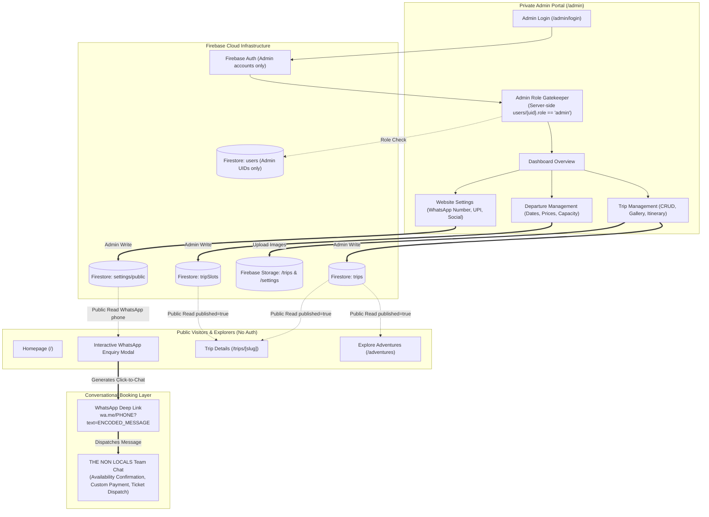
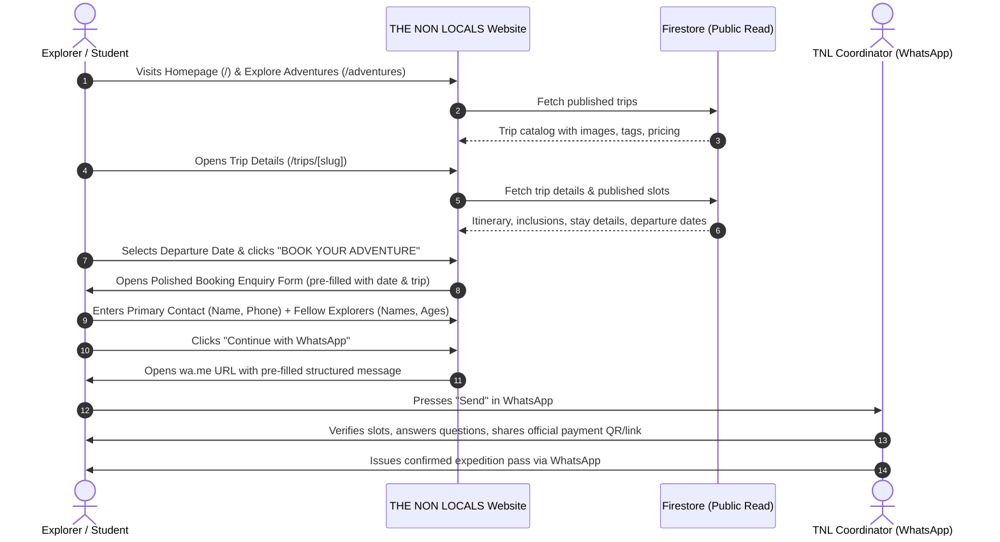
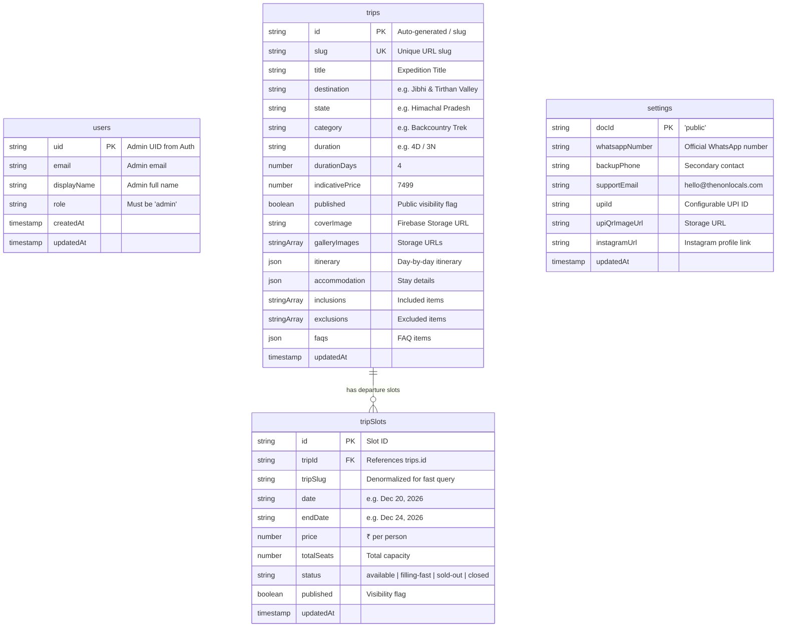
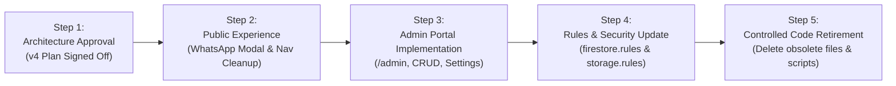

# THE NON LOCALS — Firebase Architecture Plan (v4 · Travel Discovery & WhatsApp Booking)

> **Document Version:** v4.0 · Final Architecture Specification  
> **Date:** October 31, 2026  
> **Status:** Deliberate Business Direction Pivot  
> **Supersedes:** `firebase-architecture.md` (v3 · Online Booking & Payment Platform)

---

## 1. Executive Summary & Strategic Product Pivot

### 1.1 The Pivot at a Glance
THE NON LOCALS is pivoting from a **closed customer-account and automated transactional platform** to a **high-converting travel discovery website coupled with a friction-free WhatsApp booking enquiry engine and a private admin management portal**.

```
┌────────────────────────────────────────────────────────────────────────┐
│                        PREVIOUS MODEL (v3)                             │
│ Google Sign-In Required ➔ Server Seat Hold (30 min) ➔ External UPI     │
│ Payment ➔ UTR & Screenshot Form ➔ Verification Queue ➔ Online Ticket   │
└──────────────────────────────────┬─────────────────────────────────────┘
                                   │  PIVOT
                                   ▼
┌────────────────────────────────────────────────────────────────────────┐
│                          NEW MODEL (v4)                                │
│ 100% Public Access (No Login) ➔ Interactive Trip Discovery ➔           │
│ Multi-Traveller WhatsApp Enquiry Form ➔ WhatsApp Click-to-Chat ➔       │
│ Direct Human Coordination & Payment ➔ Private Admin Portal for Ops    │
└────────────────────────────────────────────────────────────────────────┘
```

### 1.2 Core Pillars of the v4 Model
1. **Zero-Friction Customer Experience:** No customer registration, no Google login barrier, no passwords, no user profiles. Customers browse, get inspired, select departures, and enquire directly.
2. **Conversational WhatsApp Checkout:** Travel decisions are high-involvement and relational. Students and travelers submit their details and friends' names through a polished modal that formats a comprehensive enquiry message and transfers them seamlessly to the official WhatsApp coordinator with one tap.
3. **Zero Customer PII in Database:** Enquiry data is transferred entirely through the client-generated WhatsApp message. The web platform does not store personal customer records, transaction IDs, or payment screenshots, dramatically reducing regulatory overhead, privacy risk, and database clutter.
4. **Authoritative Private Admin Portal (`/admin`):** Full content and operational control for THE NON LOCALS operations team. Admins authenticate securely via Firebase Auth, manage trips, upload imagery to Firebase Storage, adjust departure schedules and seat availability manually, and update the official business WhatsApp number in real time.

---

## 2. High-Level System Architecture



---

## 3. Public Customer Journey

The entire customer journey requires zero authentication, zero redirects, and zero session barriers.



---

## 4. WhatsApp Booking & Enquiry System Specification

### 4.1 Form Data Model
The client-side enquiry modal collects the following structured inputs:

```typescript
export interface BookingEnquiryFormValues {
  // Primary Contact
  primaryName: string;
  primaryPhone: string;

  // Expedition Details (pre-selected from page)
  tripTitle: string;
  tripSlug: string;
  departureDate: string;
  slotId?: string;
  joiningType: "solo" | "group";

  // Dynamic Party Information
  travellersCount: number;
  travellers: Array<{
    fullName: string;
    age?: number | string;
  }>;

  // Optional Special Request
  notes?: string;
}
```

### 4.2 Dynamic Travellers Array Behavior
- If `travellersCount` is changed, the form dynamically adjusts the traveller fields.
- For `travellersCount === 1` and `joiningType === "solo"`, Traveller #1 auto-fills with the Primary Contact's name.
- For group bookings, users can dynamically click **"+ Add Friend"** or **"Remove"**, up to a maximum of 12 explorers per enquiry.
- Each entry requires the traveller's full name; age is optional (recommended for student cohort verification).

### 4.3 Client-Side Validation Rules (Zod Schema)
```typescript
import { z } from "zod";

export const BookingEnquirySchema = z.object({
  primaryName: z
    .string()
    .min(2, "Full name must be at least 2 characters")
    .max(60, "Full name cannot exceed 60 characters"),
  primaryPhone: z
    .string()
    .regex(/^[0-9+ ]{10,15}$/, "Please enter a valid 10-digit mobile number"),
  tripTitle: z.string().min(1),
  tripSlug: z.string().min(1),
  departureDate: z.string().min(1, "Please select an expedition departure date"),
  joiningType: z.enum(["solo", "group"]),
  travellersCount: z.number().min(1).max(12),
  travellers: z.array(
    z.object({
      fullName: z.string().min(2, "Traveller name is required"),
      age: z.string().optional(),
    })
  ).min(1, "At least one traveller must be entered"),
  notes: z.string().max(300).optional(),
});
```

### 4.4 Structured WhatsApp Message Template
The message generated by the modal is human-readable, beautifully structured with emoji signposts, and clearly identifies the student cohort context:

```text
Hi THE NON LOCALS team! 🏔️
I would like to book an expedition for our group. Here are our booking details:

📍 EXPEDITION: Jibhi & Tirthan Valley Expedition
📅 DEPARTURE DATE: December 20, 2026
👥 PARTY SIZE: 3 Explorers (Group Joining)

👤 PRIMARY CONTACT:
• Name: Yatharth Gupta
• Phone: +91 98765 43210

🎒 TRAVELLER DETAILS:
1. Yatharth Gupta (Age: 20)
2. Rohan Sharma (Age: 21)
3. Ananya Verma (Age: 20)

💬 SPECIAL REQUESTS:
Prefer quad-sharing cottage together.

Please let us know slot availability and how to complete the payment to lock our tickets!
```

### 4.5 Click-to-Chat Deep Linking & URL Encoding
- Target URL: `https://wa.me/${sanitizedPhone}?text=${encodeURIComponent(formattedMessage)}`
- `sanitizedPhone` is stripped of all spaces, dashes, and leading `+`, retaining only country code and digits (e.g., `919876543210`).
- Opens with `target="_blank"` and `rel="noopener noreferrer"`.
- Supports WhatsApp Web on desktop and native WhatsApp app via iOS/Android deep link protocols.
- **Notice to Customer:** An intuitive banner states:
  > *"Tapping below will open WhatsApp with your enquiry pre-filled. Please tap **Send** inside WhatsApp to connect with our team!"*
- **Error Handling:** If the WhatsApp number has not been configured in `settings/public`, the form disables the CTA and displays a friendly notice: *"Expedition booking line is undergoing scheduled maintenance. Please reach out via Instagram @thenonlocals or email us."*

### 4.6 Zero Server Persistence & Privacy Assurance
- Customer enquiry details are **never stored** in Firestore, Firebase Realtime Database, or Firebase Storage.
- Eliminates compliance burdens, avoids data leakage risks, and ensures customer data moves directly between the user's browser and WhatsApp.
- Includes a concise privacy disclaimer:
  > *"🔒 Your details are not stored on our web servers. They are transferred directly to THE NON LOCALS via official WhatsApp chat for booking coordination."*

---

## 5. Admin Portal Architecture (`/admin`)

The `/admin` portal is the operations hub of THE NON LOCALS. Access is strictly role-gated.

```
/admin
├── /admin/login                 ← Secure email/password or Google admin authentication
├── /admin (Dashboard)           ← Inventory overview, upcoming departure stats, quick links
├── /admin/trips                 ← Trip catalog management (create, edit, publish, archive)
│   ├── /admin/trips/new         ← Create new expedition
│   └── /admin/trips/[id]/edit   ← Edit itinerary, cover image, gallery, highlights, FAQs
├── /admin/departures            ← Departure slots management (dates, prices, availability)
└── /admin/settings              ← Website settings (WhatsApp number, UPI ID, QR image, social)
```

### 5.1 Admin Authentication & Role Provisioning
1. **No Public Sign-Up:** There is no registration page for admins.
2. **Server-Side Role Provisioning:** Only the project owner can assign the `"admin"` role to a user UID by running the offline script:
   ```javascript
   // scripts/provision-admin.js (run locally via Firebase Admin SDK)
   const admin = require("firebase-admin");
   admin.initializeApp();
   await admin.firestore().doc(`users/${TARGET_UID}`).set({
     uid: TARGET_UID,
     email: TARGET_EMAIL,
     role: "admin",
     updatedAt: admin.firestore.FieldValue.serverTimestamp(),
   }, { merge: true });
   console.log("Admin privileges provisioned for:", TARGET_UID);
   ```
3. **Route Gatekeeper (`AdminGuard.tsx`):**
   - Intercepts all requests under `/admin/*` (except `/admin/login`).
   - Verifies that `auth.currentUser != null`.
   - Reads `users/{uid}` directly from Firestore; validates `role === 'admin'`.
   - If unauthorized, redirects to `/admin/login?error=unauthorized`.
4. **Firestore Security Enforcement:** Frontend route protection is merely a convenience. All read/write privileges on drafts, trips, slots, and settings are strictly enforced by Firestore Security Rules.

### 5.2 Four Core Admin Modules

#### Module A: Admin Dashboard
- **Trip Inventory Metrics:** Total trips, active published trips, unpublished drafts.
- **Departure Metrics:** Total upcoming departures, filling-fast departures, sold-out departures.
- **Quick Actions:** Create New Trip, Add Departure Slot, Update WhatsApp Business Line, View Live Website.

#### Module B: Trip Management
- **Basic Info:** Title, Slug (auto-generated URL slug with custom override), Destination, State, Region, Category, Difficulty, Duration (Days & Nights), Age Requirement.
- **Pricing & Tags:** Base indicative price, custom badge (e.g. `"Campus Favorite"`, `"Limited Batch"`).
- **Media Manager:**
  * Cover image uploader (Firebase Storage: `/trips/{tripId}/cover.{ext}`).
  * Multi-image gallery uploader with drag-and-drop ordering and delete controls.
- **Structured Content Editors:**
  * Day-by-day Itinerary Builder (Day number, title, description, altitude, stay type, activities).
  * Accommodation Details (Stay type, room sharing options, amenities, photos).
  * Inclusions & Exclusions lists.
  * Experience Highlights & FAQs editor.
- **Publish Toggle:** Instant toggle between `published: true` (live on site) and `published: false` (hidden draft).

#### Module C: Departure & Slot Management
Because online automated seat holds are deprecated, availability is managed with total clarity by the operations team:
- **Add / Edit Departure Slots:**
  * Trip reference selector.
  * Departure Date & Return Date.
  * Price per person (₹).
  * Total seat capacity (e.g., 20 seats).
  * Current seat availability status:
    - `"available"` (Green badge: Seats Open)
    - `"filling-fast"` (Amber badge: Few Spots Left)
    - `"sold-out"` (Red badge: Batch Full)
    - `"closed"` (Grey badge: Registration Closed)
- **Archive Past Departures:** One-click archiving of past dates to keep the customer view clean.

#### Module D: Website Settings Management
- **Official WhatsApp Number:** Direct input for the phone number powering the website's booking enquiry CTA (e.g., `+91 98765 43210`).
- **Emergency / Backup Contact:** Secondary contact number.
- **Payment Reference Info (Optional):**
  * Business UPI ID (e.g. `thenonlocals@okhdfcbank`) for display or manual sharing.
  * Official UPI QR Code upload (Firebase Storage: `/settings/upi-qr.png`).
- **Social & Brand Links:** Instagram handle, campus ambassador links.

---

## 6. Firestore Database Architecture (v4)

The v4 architecture drastically simplifies the database. Only 4 collections exist, separating public content from administrative governance.

### 6.1 Database Schema Diagram



### 6.2 Detailed Collection Specifications

#### 1. `trips` Collection
```typescript
export interface FirestoreTrip {
  id: string;
  slug: string;
  title: string;
  destination: string;
  state: string;
  duration: string;
  durationDays: number;
  departureLocation: string;
  maxGroupSize: number;
  minAge: number;
  category: string;
  difficulty: string;
  description: string;
  tagline: string;
  highlights: string[];
  inclusions: string[];
  exclusions: string[];
  itinerary: FirestoreItineraryDay[];
  accommodation: FirestoreAccommodation;
  experienceHighlights: FirestoreTripHighlight[];
  faqs: FirestoreFAQItem[];
  coverImage: string;
  galleryImages: string[];
  indicativePrice: number;
  published: boolean;
  order?: number;
  createdAt: Timestamp;
  updatedAt: Timestamp;
}
```

#### 2. `tripSlots` Collection
```typescript
export interface FirestoreTripSlot {
  id: string;
  tripId: string;
  tripSlug: string;
  date: string;
  endDate?: string;
  month?: string;
  price: number;
  totalSeats: number;
  availableSeats?: number;
  status: "available" | "filling-fast" | "sold-out" | "closed";
  published: boolean;
  createdAt: Timestamp;
  updatedAt: Timestamp;
}
```

#### 3. `settings` Collection (`settings/public`)
```typescript
export interface FirestorePublicSettings {
  whatsappNumber: string;
  backupPhone?: string;
  supportEmail?: string;
  upiId?: string;
  upiName?: string;
  upiQrImageUrl?: string;
  instagramUrl?: string;
  updatedAt: Timestamp;
}
```

#### 4. `users` Collection (Admin Identity Only)
```typescript
export interface FirestoreAdminUser {
  uid: string;
  email: string;
  displayName?: string;
  role: "admin";
  createdAt: Timestamp;
  updatedAt: Timestamp;
}
```

### 6.3 Deprecated Collections (To Be Safely Decommissioned)
| Deprecated Collection | Reason for Deprecation |
|---|---|
| `bookings` | Customer bookings are coordinated via WhatsApp and recorded by admin ops; no web database records needed. |
| `payments` | Customer payment verification occurs externally via WhatsApp coordinator; no web uploads or declarations. |
| `utrIndex` | Duplicate UTR tracking is unnecessary in a conversational checkout. |
| `notifications` | In-app user notifications are deprecated along with customer accounts. |

---

## 7. Firebase Storage Architecture (v4)

Storage is strictly reserved for public content media and admin assets.

### 7.1 Bucket Path Layout
```
gs://<project-id>.appspot.com/
├── trips/
│   └── {tripId}/
│       ├── cover.jpg
│       ├── gallery_01.jpg
│       └── gallery_02.jpg
└── settings/
    ├── upi-qr.png
    └── brand-assets/
```

### 7.2 Storage Security Matrix
| Path Pattern | Read Permission | Write Permission | Constraints |
|---|---|---|---|
| `/trips/{tripId}/{fileName}` | **Public** (`true`) | **Admin Only** | Image type only, max 10MB per image |
| `/settings/{fileName}` | **Public** (`true`) | **Admin Only** | Image type only, max 5MB |
| `/payment-screenshots/**` | **BLOCKED** (`false`) | **BLOCKED** (`false`) | Deprecated path — completely disabled |
| `/{allPaths=**}` | **BLOCKED** (`false`) | **BLOCKED** (`false`) | Default closed |

---

## 8. Firestore & Storage Security Rules (v4)

### 8.1 Production `firestore.rules` (v4)
```javascript
rules_version = '2';
service cloud.firestore {
  match /databases/{database}/documents {

    // ── Helper: Admin Verification ──────────────────────────────────────────
    function isSignedIn() {
      return request.auth != null;
    }

    function isAdmin() {
      return isSignedIn()
        && exists(/databases/$(database)/documents/users/$(request.auth.uid))
        && get(/databases/$(database)/documents/users/$(request.auth.uid)).data.role == 'admin';
    }

    // ── 1. trips ────────────────────────────────────────────────────────────
    match /trips/{tripId} {
      // Public visitors can only view published trips
      allow read: if resource.data.published == true || isAdmin();
      // Only authorized admins can create, edit, or delete trips
      allow write: if isAdmin();
    }

    // ── 2. tripSlots ────────────────────────────────────────────────────────
    match /tripSlots/{slotId} {
      // Public visitors can only view published departure dates
      allow read: if resource.data.published == true || isAdmin();
      // Only authorized admins can manage departure dates and capacity
      allow write: if isAdmin();
    }

    // ── 3. settings/public ──────────────────────────────────────────────────
    match /settings/public {
      // Public visitors can read settings (e.g. official WhatsApp number)
      allow read: if true;
      // Only authorized admins can update settings
      allow write: if isAdmin();
    }

    // ── 4. users (Admin Identity Only) ──────────────────────────────────────
    match /users/{uid} {
      // Admins can read their own identity profile
      allow read: if isSignedIn() && request.auth.uid == uid && resource.data.role == 'admin';
      // No client-side creates or updates — roles provisioned server-side via Admin SDK
      allow write: if false;
    }

    // ── 5. Deprecated Collections (Strictly Closed) ─────────────────────────
    match /bookings/{id} {
      allow read, write: if false;
    }
    match /payments/{id} {
      allow read, write: if false;
    }
    match /utrIndex/{id} {
      allow read, write: if false;
    }
    match /notifications/{id} {
      allow read, write: if false;
    }

    // Fallback: Deny everything else
    match /{document=**} {
      allow read, write: if false;
    }
  }
}
```

### 8.2 Production `storage.rules` (v4)
```javascript
rules_version = '2';
service firebase.storage {
  match /b/{bucket}/o {

    function isSignedIn() {
      return request.auth != null;
    }

    function isAdmin() {
      return isSignedIn()
        && firestore.exists(/databases/(default)/documents/users/$(request.auth.uid))
        && firestore.get(/databases/(default)/documents/users/$(request.auth.uid)).data.role == 'admin';
    }

    // ── Trip Cover & Gallery Images ─────────────────────────────────────────
    match /trips/{tripId}/{fileName} {
      allow read: if true;
      allow write: if isAdmin()
                   && request.resource.size < 10 * 1024 * 1024
                   && request.resource.contentType.matches('image/.*');
    }

    // ── Website & Brand Settings Assets ─────────────────────────────────────
    match /settings/{fileName} {
      allow read: if true;
      allow write: if isAdmin()
                   && request.resource.size < 5 * 1024 * 1024
                   && request.resource.contentType.matches('image/.*');
    }

    // ── All other paths closed ──────────────────────────────────────────────
    match /{allPaths=**} {
      allow read, write: if false;
    }
  }
}
```

---

## 9. Obsolete Code & Cloud Functions Inventory

A thorough audit of the repository reveals the specific components, services, and functions that will be cleanly retired in the migration:

### 9.1 Obsolete Backend Functions (`functions/src/index.ts`)
| Function | Original Role (v3) | Disposition in v4 |
|---|---|---|
| `createBooking` | Server-side transaction to reserve seats & hold pending booking | **Deprecate & Remove** — enquiries go to WhatsApp directly |
| `submitPaymentDetails` | Atomic UTR uniqueness check & payment record creation | **Deprecate & Remove** — payments handled directly via WhatsApp |
| `cancelBooking` | Server-side reservation cancellation & seat restoration | **Deprecate & Remove** — no automated booking records |
| `expireBookings` | Scheduled pub/sub task expiring uncompleted reservations | **Deprecate & Remove** — no auto-expiring bookings |
| `onUserCreate` | Auth trigger creating `users/{uid}` for every Google login | **Deprecate & Remove** — customer accounts eliminated; admins provisioned via script |

### 9.2 Obsolete Client Pages & Routes
| Path | Current Role | Disposition in v4 |
|---|---|---|
| `src/app/auth/page.tsx` | Customer Google Sign-in page | **Deprecate** (Replace with `/admin/login` for administrators only) |
| `src/app/dashboard/page.tsx` | Customer booking history & confirmed tickets dashboard | **Deprecate & Remove** |
| `src/app/profile/page.tsx` | Customer profile management page | **Deprecate & Remove** |
| `src/app/bookings/[id]/payment/page.tsx` | Payment submission & countdown timer page | **Deprecate & Remove** |

### 9.3 Obsolete Frontend Components & Services
| Component / Service | File Path | Disposition in v4 |
|---|---|---|
| `BookingModal.tsx` | `src/components/trip-details/BookingModal.tsx` | **Replace** with `WhatsAppEnquiryModal.tsx` |
| `UserMenu.tsx` | `src/components/auth/UserMenu.tsx` | **Remove from public navigation** |
| `GoogleSignInButton.tsx` | `src/components/auth/GoogleSignInButton.tsx` | **Remove** |
| `AuthGuard.tsx` | `src/components/auth/AuthGuard.tsx` | **Repurpose** into `AdminGuard.tsx` for `/admin/*` routes |
| `bookingTransactionService.ts` | `src/lib/firebase/services/bookingTransactionService.ts` | **Retire** |
| `bookingsService.ts` | `src/lib/firebase/services/bookingsService.ts` | **Retire** |

---

## 10. Architecture Comparison Matrix (v3 vs v4)

| Dimension | Previous Architecture (v3) | New Architecture (v4) | Business Impact |
|---|---|---|---|
| **Primary Value Proposition** | Automated self-serve transactional travel portal | Engaging travel discovery site + high-touch WhatsApp closing | Higher conversion; matches student buying habits |
| **Customer Authentication** | Mandatory Google OAuth before booking | **Zero authentication required** for visitors | Eliminates sign-in drop-off completely |
| **Booking Mechanism** | Multi-step form, Cloud Function transaction, 30-min seat hold | **Polished enquiry modal with dynamic friends list ➔ WhatsApp deep link** | Instant human communication; builds immediate trust |
| **Payment Workflow** | Online UTR submission, screenshot file upload, queue review | **Direct payment via WhatsApp** with coordinator | Eliminates UTR errors, upload failures, and form friction |
| **Seat Inventory Model** | Automated atomic reservation counters (`reservedSeats`) | **Admin-managed slot status** (`available`, `filling-fast`, `sold-out`) | Simple, accurate operations; no oversell bugs |
| **Customer Data Storage** | Stored in `users`, `bookings`, `payments`, `utrIndex` | **Zero customer PII in database** | 100% privacy compliance; zero database clutter |
| **Cloud Functions Footprint** | 5 Cloud Functions (Callables + Scheduled PubSub + Auth trigger) | **Zero customer-facing Cloud Functions** | Massive reduction in cloud hosting & maintenance costs |
| **Admin Portal** | Verification dashboard for payments & tickets | **Complete content management hub** (Trips, Slots, Media, Settings) | Gives marketing & ops full autonomy |
| **Security Rules Surface** | Complex rules covering 10+ collections & diff keys | **Lean, airtight rules** for `trips`, `tripSlots`, and `settings` | Lower risk of rule misconfiguration |

---

## 11. Safe Migration & Cleanup Plan

To ensure absolute safety, zero disruption to current features, and documentation integrity, the transition will occur in five controlled steps:



### Step 1: Architecture Review & User Sign-Off (Current Turn)
- Deliver `firebase-architecture-v4.md`.
- Present comparative analysis and await explicit approval.
- No production files deleted in this phase.

### Step 2: Customer Experience & WhatsApp Enquiry Rollout
- Create `src/components/trip-details/WhatsAppEnquiryModal.tsx` with dynamic travellers list, validation, and click-to-chat generator.
- Update `TripBookingCard.tsx` and `TripDetailsView.tsx`: CTA displays `"BOOK YOUR ADVENTURE"` and opens the WhatsApp modal with pre-filled trip info.
- Clean public navigation (`Navbar.tsx`, `HomeNavbar.tsx`): Remove `UserMenu` and public `/auth` links from header.
- Ensure public pages (`/`, `/adventures`, `/trips/[slug]`) are 100% functional without any auth context.

### Step 3: Admin Portal Construction (`/admin`)
- Create `/admin/login` for administrative sign-in.
- Build `AdminGuard.tsx` to protect all `/admin` routes.
- Implement `/admin` Dashboard overview with key metrics.
- Implement `/admin/trips` (list, create, edit, publish toggle, gallery uploader).
- Implement `/admin/departures` (manage departure dates, prices, capacity, status).
- Implement `/admin/settings` (manage WhatsApp number, UPI ID, QR code).

### Step 4: Security Rules Deployment
- Deploy revised `firestore.rules` and `storage.rules`.
- Verify public read on published trips/slots/settings and admin write restriction.

### Step 5: Controlled Code Retirement
- Remove obsolete routes (`/dashboard`, `/profile`, `/bookings/*`, `/auth`).
- Remove obsolete Cloud Functions from `functions/src/index.ts`.
- Remove obsolete services (`bookingTransactionService.ts`, `bookingsService.ts`).
- Run full build and test suites to verify zero errors and clean logs.

---

## 12. Approval Request

This architecture document represents the **new single source of truth** for THE NON LOCALS. All architectural decisions adhere strictly to your instructions.

Awaiting your review and approval to proceed with **Step 2 (Customer Experience & WhatsApp Enquiry Rollout)**.

